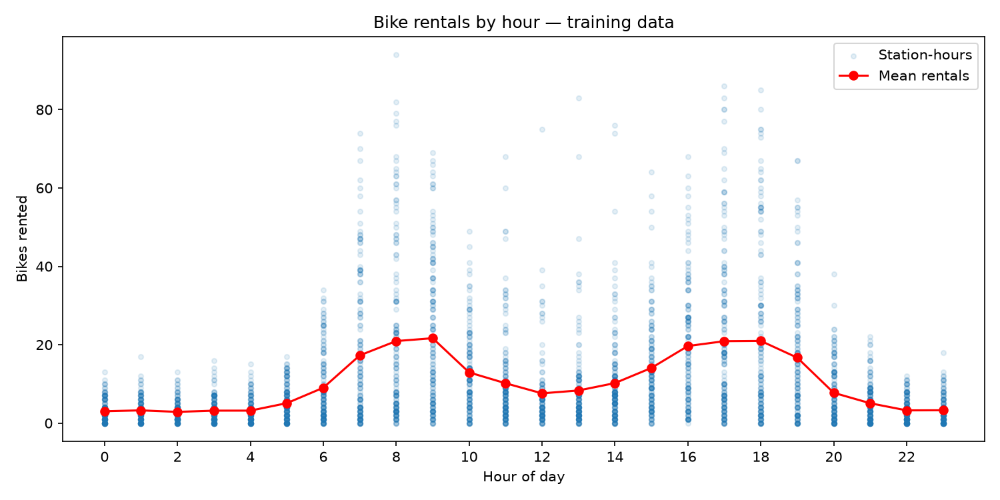
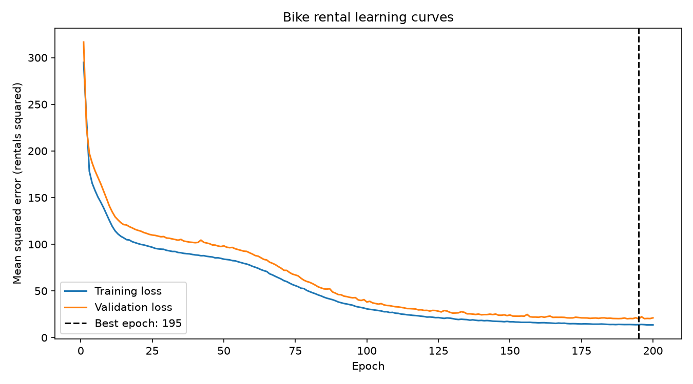
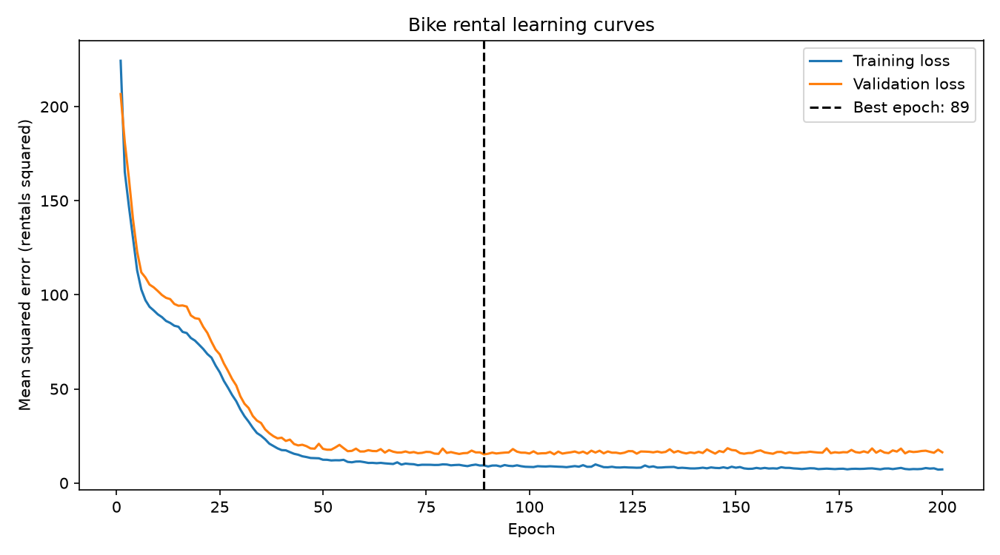
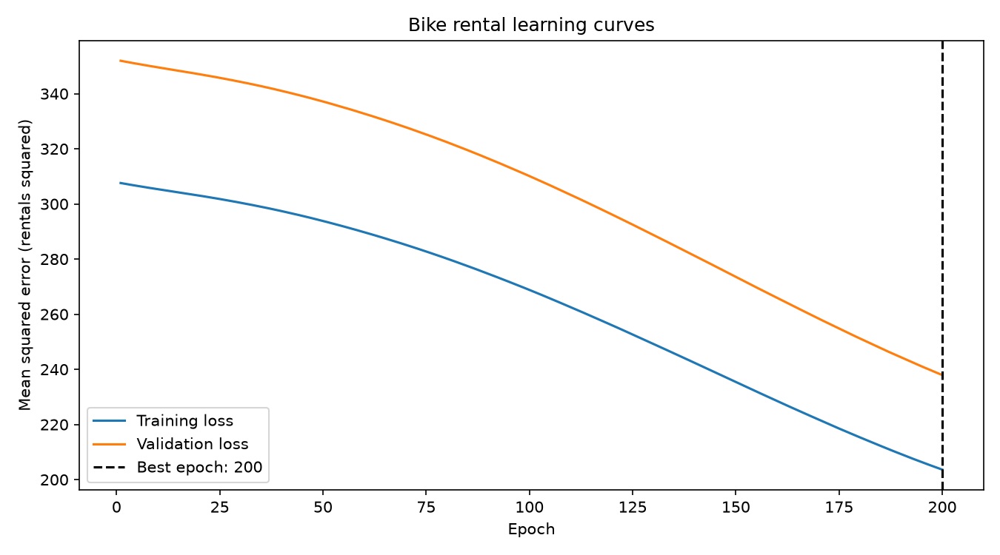

# Lakeshore Bike Demand

## What it does

This project predicts hourly bike rentals from the hour, weather,
weekend status, and station type. It uses a PyTorch neural network
with a manually written training loop and compares it with a
training-mean predictor and linear regression.

## How to run it

From the repository folder:

```bat
conda env create -f environment.yml
conda activate lab07-first-principles
python train.py
```

The training command recreates the plots, histories, experiment
table, and metrics in `reports/`.

Run the project checks:

```bat
python -m ruff format --check .
python -m ruff check .
python -m pytest
```

The requirements files pin the installed package versions.
The project runs on the CPU.

## Data and split

The unchanged `bikes_data.py` generates 6,000 synthetic station-hour
records using data seed 2026. The target is `rentals`.

The rows are split before preprocessing using random seed 42:

| Split | Rows | Percentage |
|---|---:|---:|
| Training | 3,600 | 60% |
| Validation | 1,200 | 20% |
| Test | 1,200 | 20% |

First, 60% of rows are assigned to training. The remaining 40%
are split equally into validation and test rows.

The standard scaler and one-hot encoder are fitted on training
rows only. The same fitted transformations are applied to validation
and test rows, preventing information from those rows from
influencing preprocessing.

Five numeric features are standardized. Station type is one-hot
encoded into three features, producing eight input features.
A custom Dataset returns float32 feature vectors and scalar targets.
Only the training DataLoader shuffles its rows.

The following plot uses training rows only.



Average demand has morning and late-afternoon peaks, with lower
rentals overnight. A straight-line relationship with hour cannot
represent both peaks.

## Model and training

The initial network has hidden layers of 64 and 32 neurons.
The wider experiment has hidden layers of 256 and 128 neurons
and was selected as the final model using validation loss.

Both networks use ReLU after each hidden layer and a single
linear output with no output activation. Predictions have shape
`(N,)`, matching the targets.

Training uses:

- Mean squared error (MSE) loss.
- Adam optimizer.
- Batch size 64.
- 200 epochs per experiment.
- Learning rate 0.001, except in the slow-learning experiment.
- PyTorch seed 42 and DataLoader generator seed 42.
- One CPU thread.

The epoch function explicitly clears gradients, computes predictions
and loss, calls `loss.backward()`, and calls `optimizer.step()`.
Without an optimizer, it evaluates without recording gradients or
updating weights.

Loss and MAE are averaged by the number of rows, including the
last batch. Each epoch's training loss, training MAE, validation
loss, and validation MAE are logged.

The training function copies the weights whenever validation MSE
improves and restores the lowest-validation-MSE checkpoint after
training.

A small-batch check confirmed that the network could memorize
16 training rows. The automated tests also check actual learning
and clearing old gradients.

The seeds make runs repeatable on the same computer and environment.
The last digits may differ on other computers.

## Results

MAE is measured in rentals; lower is better.

| Model | Validation MAE | Test MAE |
|---|---:|---:|
| Training-mean predictor | 10.154 | 9.649 |
| Linear regression | 9.317 | 8.573 |
| Selected neural network | 2.584 | 2.429 |

Both baselines are fitted using training rows only and evaluated
on the same validation and test rows as the network.

The wider network was selected using validation MSE alone.
Its best checkpoint was epoch 89, with validation MSE 15.226.
The selected checkpoint was then evaluated on the test rows.
No model settings were changed after inspecting the test result.

The network's test MAE is 2.429 rentals. Linear regression improves
on the training-mean predictor but cannot capture the two hourly
peaks with its linear hour term. Its additive features also lack
explicit interactions between hour, weekend status, weather,
and station type.

The initial network's learning curve is shown below.



Training and validation losses decrease substantially and flatten
toward the end. Validation loss remains higher than training loss,
but there is no sustained strong upward trend. Its best checkpoint
is epoch 195.

The selected wider network's curve is shown below.



It learns faster and reaches a lower validation loss. Later training
reduces training loss without a sustained validation improvement,
showing mild overfitting. Restoring epoch 89 avoids retaining the
later, worse checkpoint.

## Experiments

Each experiment changes one setting from the initial run.
All runs use the same split, batch size, epoch budget, and seeds.

| Run | Hidden sizes | Learning rate | Best epoch by validation MSE | Minimum validation MAE | MAE at best-MSE epoch | Final training MSE | Final validation MSE |
|---|---|---:|---:|---:|---:|---:|---:|
| Main | 64, 32 | 0.001 | 195 | 3.118 | 3.126 | 13.567 | 21.161 |
| Slow learning | 64, 32 | 0.00001 | 200 | 9.076 | 9.088 | 203.625 | 237.950 |
| Wider network | 256, 128 | 0.001 | 89 | 2.575 | 2.584 | 7.225 | 16.331 |

Minimum validation MAE and the MAE at the best-MSE epoch can
differ because the checkpoint is selected using MSE, not MAE.
Final losses describe epoch 200 before restoring the best weights.

The main run learns successfully but reaches a higher validation
error than the wider model.

The slow-learning run remains underfit within the 200-epoch budget.
Both losses are high and still falling, indicating that the small
learning rate has not allowed enough progress.



The wider network learns useful patterns faster and achieves the
best validation MSE. Its widening training-validation gap later in
training indicates mild overfitting, so the best saved checkpoint
is used for the final evaluation.

Full-precision results are saved in `reports/experiments.csv` and
`reports/metrics.json`. Per-epoch histories are also saved.

## Limitations

The data represent an invented bike-share scenario, not measured
rentals from real stations. Good performance on this synthetic
table does not establish performance in a real city.

The model cannot see station capacity, available bikes, holidays,
special events, actual station identity, or recent rental history.
It cannot distinguish low demand from rentals limited by an empty
station.

The random split evaluates new rows from the same synthetic
distribution. It does not test forecasting future periods,
unseen station types, or changing travel patterns.

The linear output can produce negative or fractional predictions
and does not provide prediction intervals. Predictions should not
be treated as guaranteed counts or used alone to make operational
bike-moving decisions.